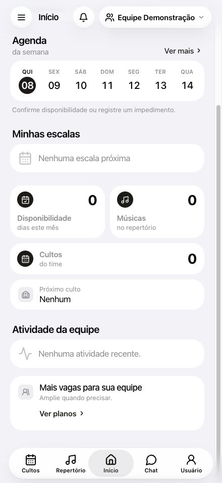
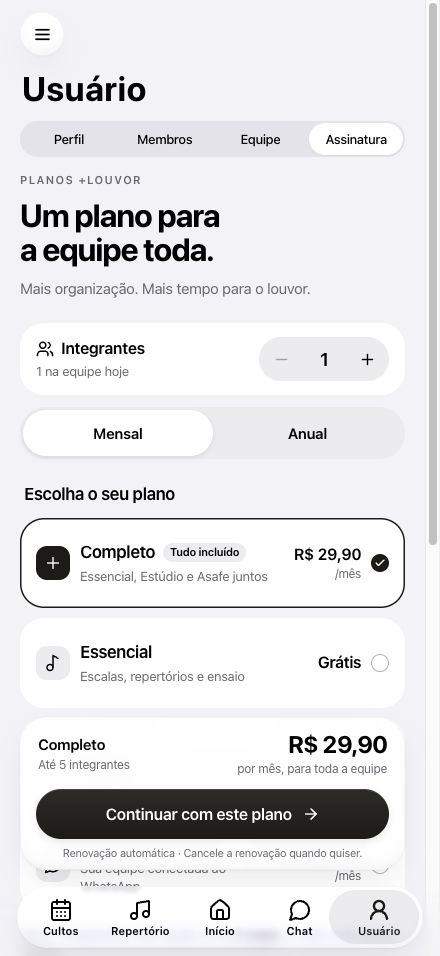
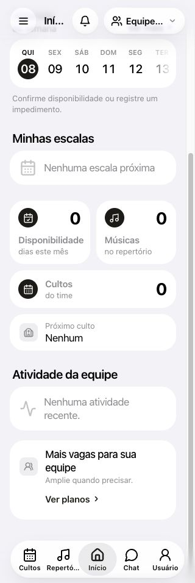
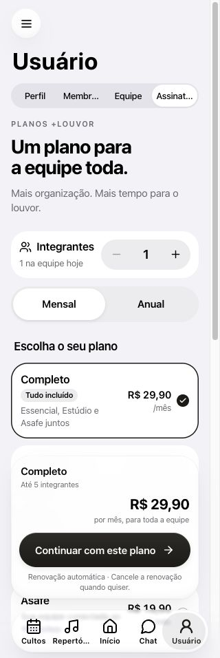

# QA visual — Home e aba Assinatura

Capturas locais da interface implementada em `5beff48`, verificadas em 8 de outubro de 2026 (Fortaleza). Não são capturas de uma conta real nem evidência de compra/publicação.

## Cenário

- Componentes reais `AppLayout`, `Home` e `TeamSettings`, com aparência nativa iOS.
- Proprietário fictício de uma equipe gratuita, um integrante e nenhuma atividade.
- Supabase, RPCs de assinatura, RevenueCat e push substituídos por fixtures locais.
- **Os preços nas imagens são fictícios**, usados apenas para verificar a apresentação dos planos. Não representam o catálogo aprovado na App Store.
- Escritas, compras, restauração e gerenciamento de assinatura são bloqueados. A política de conteúdo restringe conexões à origem local e ao websocket do Vite.

Para reproduzir a prévia na raiz do repositório:

```sh
npx vite --config scripts/store-screens/home.config.mjs
```

Abrir `http://127.0.0.1:5196/scripts/store-screens/home.html`. O parâmetro `?screen=billing` abre diretamente a aba Assinatura. A fixture só implementa as rotas Home e Usuário.

## Resultado

| Verificação | 440 × 956 | 320 × 956 |
| --- | --- | --- |
| Largura do documento | 440 px | 320 px |
| Área principal: largura visível / total | 425 / 425 px | 305 / 305 px |
| Overflow horizontal | Nenhum | Nenhum |
| Chamada abaixo de Atividade da equipe | Confirmado | Confirmado |
| `Ver planos` abre Assinatura selecionada | Confirmado | Confirmado |
| Botão `Voltar` de tela na Assinatura | Ausente | Ausente |
| Barra inferior de abas | Visível e funcional | Visível e funcional |

Também foi verificada a troca `Perfil → Assinatura` pela navegação interna e o retorno à Home pela aba `Início`. Nenhuma compra foi acionada. A assinatura e a Home mantiveram a mesma largura total da viewport. A diferença de 15 px na área principal corresponde à barra de rolagem do Chrome.

Em 320 px, o título da chamada ocupa duas linhas dentro do card. As abas longas do usuário mantêm seus nomes acessíveis completos e abreviam visualmente com reticências. A Home tem rolagem vertical normal; as capturas mostram a parte inferior para incluir Atividade, chamada e navegação.

Essa verificação cobre layout e navegação em Chrome com dimensões explícitas. Não substitui teste de StoreKit, valores reais, safe area física ou compra no TestFlight.

## Imagens

Home 440 × 956:



Assinatura 440 × 956:



Home 320 × 956:



Assinatura 320 × 956:


